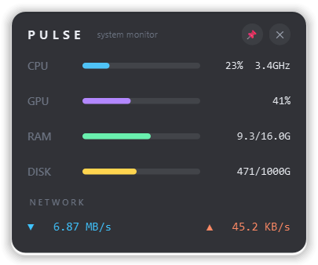

# Strix Pulse Monitor

> A sleek, always-on-top **desktop system monitor** — live CPU, GPU, RAM and disk
> usage plus real-time network download/upload, in a frameless glass widget you can
> drag anywhere. Offline, no telemetry.

[](LICENSE)
[](#installation)
[](SECURITY.md)



Part of the open-source **[Strix Advanced Tools](https://github.com/strix-tool)** suite.

## Features

- Live **CPU, GPU, RAM, Storage** usage and **network down/up** traffic, refreshed once a second.
- **Frameless glass widget** — drag to move, pin to lock, hide to tray.
- **Resizable, zoomable card** — drag any corner for a proportional 0.5×–4× window,
  or Ctrl+wheel in eased 10 % steps. Text scales with the window up to 2× and then stays
  put, so a large card stays sharp instead of turning into billboard digits.
- **GPU support:** NVIDIA via `nvidia-smi` (utilisation **and VRAM used/total**); on Windows,
  Intel/AMD via GPU performance counters (utilisation only); on **Linux, AMD via sysfs**
  (`gpu_busy_percent` + `mem_info_vram_*`, no root). Falls back to N/A gracefully.
- Position, size/zoom and pin state saved and restored between runs.
- **About dialog** — the tray and widget menus show the running version and a
  one-click GitHub logo that opens the project fork, in a larger fixed-size card
  so the version and link stay readable.
- **Hardened:** no network, no shell strings, no elevation. Settings are validated on load
  and written atomically. See [SECURITY.md](SECURITY.md).

## Screenshots

See [`docs/screenshots/`](docs/screenshots/).

## Installation

### Windows

Download **`Strix Pulse Monitor Setup.exe`** from
[Releases](https://github.com/quantumblow/strix-pulse-monitor/releases) and run the
wizard. Or run from source:

```bat
pip install -r requirements.txt
python pulse_monitor.py
```

> Unsigned build → SmartScreen shows "unknown publisher" on first run; choose
> **More info → Run anyway**. See [docs/install-windows.md](docs/install-windows.md).

### Linux (Ubuntu / Debian)

```bash
sudo apt install ./strix-pulse-monitor_1.0.4_all.deb     # from Releases
# or from source:
sudo ./linux/install.sh            # add --user for a per-user install
./linux/install.sh --user --autostart   # start automatically with your session
```

Requires `python3-psutil` and **PySide6** (`python3-pyside6.*` or `pip install PySide6`).
Details: [docs/install-linux.md](docs/install-linux.md).

## Controls

| Action | How |
|---|---|
| Move | Left-click and drag |
| Resize | Drag any corner (aspect ratio kept, opposite corner anchored) |
| Zoom | Ctrl + mouse wheel — eased 10 % per notch, 0.5×–4× |
| Pin / lock | Click the pin button (stops moving; corners still resize) |
| Hide to tray | Click ✕ |
| Show/hide | Click the tray icon |
| About / GitHub | Right-click the widget or tray icon → About |
| Exit | Right-click tray → Exit |

## Start automatically

- **Windows:** put a shortcut to the app in `shell:startup`.
- **Linux:** `./linux/install.sh --user --autostart`, or copy the `.desktop` into
  `~/.config/autostart`.

## Requirements

| Component | Windows | Linux |
|---|---|---|
| Python 3.10+ | from source | `python3` |
| PySide6 | `pip` | `python3-pyside6.*` / `pip` |
| psutil | `pip` | `python3-psutil` |

## License

[MIT](LICENSE) © 2026 Strix Advanced Tools.
